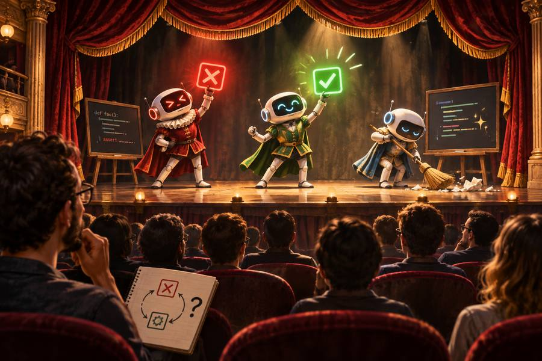

> Does a coding agent need every step of Red-Green-Refactor? I tried to find out. Here is what I changed, what I measured, and what I learned.

<!--more-->

## Key takeaways

- **Known change:** write the tests together.
- **Unknown change:** one test at a time.
- **Ask for proof:** tests fail without the code.
- **Start from your workflow first,** cut steps later.
- **Judge the workflow:** by its results, not its steps.

## Red. Green. Refactor.

If you practice Test-Driven Development, you know this rhythm well. Kent Beck described it in _Test-Driven Development: By Example_ more than twenty years ago, and I have been following it for years. It helps me find a good design, keep things simple, and move forward in small steps.

Lately I have been working on [aido](https://github.com/joebew42/aido), an agentic workflow. It explores how much of the coding we can hand over to AI while keeping good engineering practices. It is an experiment, but also a workflow that works, one of many out there. TDD was part of it from the start: write one failing test, write just enough code to make it pass, clean up, and repeat.

But a coding agent is not a human developer. In aido, the agent starts from an approved specification and a plan. It already knows what to build before it writes the first test.

Last week, I had a session about AI coding agents with [Pietro Di Bello](https://github.com/xpepper). During the session, Pietro shared Birgitta Böckeler's article [TDD inside the agent loop - theater or actual value?](https://martinfowler.com/articles/exploring-gen-ai/tdd-in-the-agent-loop.html). Out of curiosity, we discussed it a little, and decided to experiment with **cutting the TDD ceremony out of aido**.

The experiment is in [aido PR #47](https://github.com/joebew42/aido/pull/47). The sections below go through these takeaways.

## 1. Knowns and unknowns

The question is not whether to use TDD or not. It is: **can this small step tell the agent something it doesn't already know?** Running a test is only useful if the result can surprise you.

**A known change** is one where the agent can guess the result. In the small TODO app used to test aido, for example:

- turning a task into a line of JSON,
- a "complete a task" command that works like the existing "add a task",
- a simple object that holds a task's title and due date.

Here, the agent can work **inside-out**: write all the tests for the piece of code, then the code, and expect them to pass. Returning a fake value first, and then adding a second test to force the real code (_triangulation_), teaches the agent nothing new.

**An unknown change** touches something the agent can't fully see: existing code, a real service like a calendar API whose errors nobody has seen yet, or unclear rules like "repeat monthly" on the 31st. Here, one test at a time shows a mistake after one step instead of ten.

Working **outside-in** helps too. The agent first connects the new feature end to end, with one simple test (a _tracer bullet_). If the plan is wrong, you find out early, before the agent spends time on the details.

One experiment showed the difference. Claude suggested hiding a trap in an existing helper: `task_title` quietly makes the first letter of a title uppercase. The existing test uses _"Pay rent"_, which already starts with an uppercase letter, so you can't see it. The agent had to build a new feature that uses this helper.

When it wrote all the tests together, the agent guessed how the helper worked before running anything. When it wrote one test at a time, the first test run showed what the helper really does. In the first comparison, **writing the tests together cost $1.54, and one test at a time cost $1.25.** The smaller steps were cheaper.

So, together with Claude, I changed the rule. The agent writes the tests together only for simple, known pieces of code, like mappings and data objects, that don't use any existing code. When the change uses existing code, like the helper above, it goes one test at a time.

This is close to what Beck already suggested in his book: if you know what to write, just write it (_Obvious Implementation_), and go back to smaller steps when the tests surprise you.

## 2. Checking the result

One step I kept is the Red step, watching the test fail. **But now the agent has to prove it.**

Böckeler writes that _"watching a test go red is only proof of anything if someone is checking why it went red"_. Before, aido's agent only said that it had seen its tests fail. Now, when it finishes a piece of code, it removes the code for a moment, runs the new tests, sees them fail, puts the code back, and sees them pass. This proves the tests really check that code.

The rest stays as it was:

- **acceptance tests** are still written first, from the approved specification,
- every piece of code still gets **its own tests**,
- `/aido:verify` still checks, with a fresh start, that the code does what the specification says.

Maybe we don't need the agent to follow every step. **We need to be confident that the tests and the checks are useful.**

## 3. Start from your workflow, then cut

In a [previous post]() I wrote that my team didn't invent a new process: we took the way we already worked and made it agentic. Strict Red-Green-Refactor came with it.

That was a good start. Once the workflow was agentic, we could see which steps gave nothing to the agent, and cut them:

- **fake values and triangulation**: the agent writes the real code right away,
- **cleaning up after every test**: the agent now refactors once, when a piece of code is done,
- **showing every test cycle** (each round of Red-Green-Refactor) to the human: the agent finishes a piece of code, then sums up what it does and which tests cover it.

The last cut saved the most. With only the other cuts, the cost didn't change.

The steps were there to copy the way we worked before coding agents. Their main value was to slow things down, so that a human could watch and check every step.

## 4. How we measured it

aido is tested with _evals_: small tasks given to the agent, each run a few times, with automatic checks on the result. Before this change, the checks mostly looked at whether the agent followed the steps, not at whether the result was good.

Claude suggested a way to compare the old and the new version of aido on the result instead:

- **hidden tests**, which the agent never sees, check that the feature really works,
- a **mutation score** checks the agent's own tests. A mutation test makes small changes to the code, like turning a `>` into a `>=`, and checks whether the tests notice. The score is the share of changes the tests catch: 1.00 means they caught all the ones that mattered.

There were four main tasks:

1. **Build a whole feature.**
2. Check that the agent **writes the test before the code**.
3. Check that it **connects the feature end to end before the details** (outside-in).
4. Check that it **builds the core logic first** (inside-out).

There was also the hidden-helper trap from above.

For the whole feature, both versions passed every check in all 3 runs, with a mutation score of 1.00. **The cost went from $1.69 to $1.18, about 30% less.** For the trap, after changing the rule, it went from $1.11 to $0.95. For the four main tasks together, it went from $3.75 to $3.43, about 9% less.

Keep in mind:

- Each version ran only **three times per task**. That is a hint, not proof.
- Tasks 2 to 4 **stop as soon as the order of the work is clear**, before the feature is done, so they say little about cost. Some runs also hit the limit of steps they were allowed.
- The agent was **not clearly faster**: fewer steps for the whole feature, more for the trap.
- All of this was measured **on aido and a small TODO app**. Other workflows and projects may give different results.

With these limits, **the quality stayed the same, and the cost went down.**

## What I learned

TDD is not simply theater for a coding agent. Some steps help the agent find out what it doesn't know. Others only copy a process made for humans. **A feedback loop is useful when what it tells you can change your next step. Otherwise, it might just be ceremony.**

I still think TDD is a powerful design technique, for humans. Now I am trying to understand how much of it is needed when an agent does the work. _Agentic TDD_, what a nice buzzword, uh?

## References

- [TDD inside the agent loop - theater or actual value?](https://martinfowler.com/articles/exploring-gen-ai/tdd-in-the-agent-loop.html), by Birgitta Böckeler
- _Test-Driven Development: By Example_, by Kent Beck (Addison-Wesley, 2002)
- [aido PR #47: Cut the TDD steps that are theater for an agent](https://github.com/joebew42/aido/pull/47)
