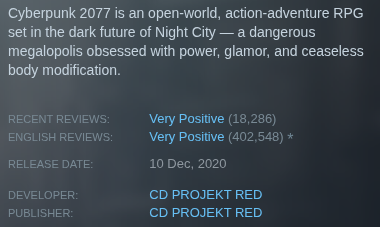
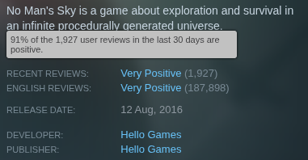

> We can spend weeks building something nobody needs. This post explores Dan North's Spike and Stabilize as two modes for product development, one to learn what is worth building and one to make it long-term maintainable, and how AI can help us learn sooner.

<!--more-->

Have you ever spent weeks designing a clean architecture, writing comprehensive documentation, and polishing every little detail, only to find out that nobody really needed what you have planned or built?

**Building the right things** and **building them the right way** are two different questions. We tend to work hard on the second one before we have an answer to the first.

What if we could learn that earlier?

What I am sharing in this post comes from my past work experience. Nowadays I am still exploring, and this post is here to help me better organize my ideas, and to see how we can push them even further.

## Incomplete doesn't mean broken

Years ago, we moved from physical media to the Internet to distribute software. This changed not only how we deliver software, but also how we develop it. Software no longer needs to be a finished artifact when it reaches its users. It can evolve through feedback, improvements, and new features.

The video game industry is an interesting example. _Cyberpunk 2077_ had a troubled release: bugs, performance issues, and disappointed players. Yet CD Projekt Red turned things around through patches, improvements, and an expansion. _No Man's Sky_ has a similar story. At the time I am writing this post, both games have _Very Positive_ reviews on Steam.

These are probably not perfect examples of how a product should be released: they are edge cases. But they show that **the first release doesn't necessarily define the future of a product.**

The _Early Access_ model takes this idea further. Players knowingly buy an unfinished game, follow its evolution, give feedback, and sometimes influence its direction. There is an agreement between developers and players: the product is incomplete, but it already delivers value.

In product development, Early Access can be compared to an **opt-in feature**: users are asked whether they want to switch to a new product, or to a new version of an existing feature, and at the same time they give feedback and help improve its final form.

I think that is the important distinction. **Incomplete doesn't necessarily mean broken.**

## Spike and Stabilize

In 2012, Dan North published _[The Art of Misdirection](https://dannorth.net/blog/the-art-of-misdirection/)_, where he looks at established engineering practices through their opportunity costs. One of the ideas he describes is **Spike and Stabilize**:

> "[...] get something, anything, into production to solicit rapid feedback, and invest in whatever survives."

The way I read it:

- **Spike**: build something, put it in front of real users, and learn. Keep the investment small, because we don't know yet whether the solution is worth keeping.
- **Stabilize**: once something proves its value, invest in making it more reliable and maintainable in the long term, and improve its design.

A spike, here, is not a throwaway prototype. It is real software running in production, which can gradually evolve into something more mature. I've been there: I have worked on spiking out the first versions of product features, and growing them later through an iterative process. It works. It helped me remove the unknowns one at a time, release after release. I wrote about one way to slice features in [Essence and Learning in Code]().

I like to think of these as **two modes of development**. During a spike, we optimize for **learning**. During stabilization, we optimize for **long-term maintainability**. And we can move between the two as often as needed.

This reminds me of Kent Beck's _[Fast/Slow in 3X: Explore/Expand/Extract](https://medium.com/@kentbeck_7670/fast-slow-in-3x-explore-expand-extract-6d4c94a7539)_, where he describes three stages of product development: **Explore**, where we experiment to discover value; **Expand**, where we overcome the bottlenecks to growth; and **Extract**, where we optimize for sustainable returns.

The two models are not the same, but they share a principle: **the practices we adopt should be connected to the outcome, and to the shortest path to get feedback and learn quickly.** Keep the focus on what matters now, on the immediate feedback, and not on a possible future we cannot predict.

## Don't stabilize assumptions

Imagine having an idea for a new digital product.

You could spend months building a complete solution, with all the features you believe your users will need. Or you could start with one small, working feature, release it, and see what happens.

Perhaps users like it. Perhaps they use it differently from what you expected. Or perhaps nobody cares. All three outcomes are useful, because you have learned something. Now you can decide what to do next: improve what works, change what doesn't, or discard the idea.

> Why invest in perfect solutions before knowing whether they will work?

This doesn't mean releasing broken software! A small product can still be reliable and useful. The point is to avoid investing too early in complexity, abstractions, and features that may never be needed.

## AI-augmented product development

We talk a lot about **AI-augmented engineering**: how AI helps us write, test, review, and maintain software. I think it is just as interesting to look at **AI-augmented product development**.

In _[Continuous Discovery Habits](https://www.goodreads.com/en/book/show/58046715-continuous-discovery-habits)_, Teresa Torres describes product discovery as a continuous process of exploring opportunities, identifying assumptions, and running experiments to learn what creates value for customers. AI today can support this process too.

We have a great opportunity to reduce not only the cost of building software, but also the cost of learning, through cheap, small and continuous releases.

AI doesn't replace the need to talk with customers, interview them, sit with them, or watch how they use the product. **AI amplifies the feedback loop.**

## `/spike` and `/stabilize`

I find it useful to make the two modes explicit, for example as two phases in an [agentic workflow]():

- **`/spike`**: optimize for discovery, experimentation, and learning. Explore the opportunities, challenge the assumptions, and build just enough to validate an idea.
- **`/stabilize`**: optimize for reliability and long-term maintainability.

They don't have to happen one after the other. A product might have a stable core, while new capabilities are explored through spikes around it.

## Wrapping up

> AI is changing how quickly we can build digital products, but not **why** we build them.

I think it is worth looking beyond how quickly we produce code (_"The Machinery Slop"_, maybe a topic for a later post), and investing more in how quickly we can explore an opportunity, test an assumption, gather feedback, and evolve what brings actual value.

**Spike to validate assumptions. Stabilize what brings real value.** And repeat.

Next time you start a new feature, try this with your team:

1. **Name the mode** you are in: spike or stabilize.
2. If it is a spike, **write down the assumption** it tests, and how you will know whether it holds.
3. When the feedback comes in, **decide together**: stabilize it, change it, or discard it.

## References

- Dan North, [_The Art of Misdirection_](https://dannorth.net/blog/the-art-of-misdirection/), 2012
- Kent Beck, [_Fast/Slow in 3X: Explore/Expand/Extract_](https://medium.com/@kentbeck_7670/fast-slow-in-3x-explore-expand-extract-6d4c94a7539)
- Teresa Torres, [_Continuous Discovery Habits: Discover Products that Create Customer Value and Business Value_](https://www.goodreads.com/en/book/show/58046715-continuous-discovery-habits), 2021
